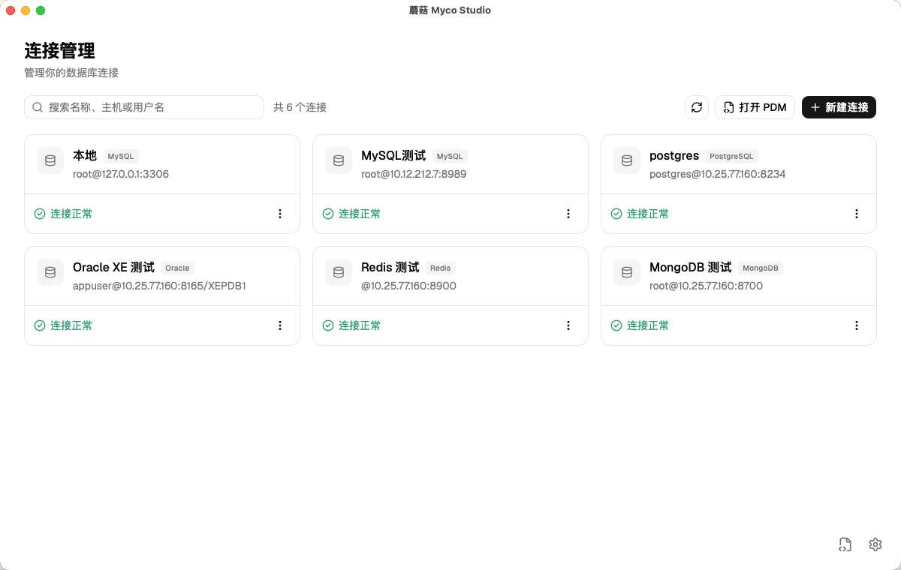
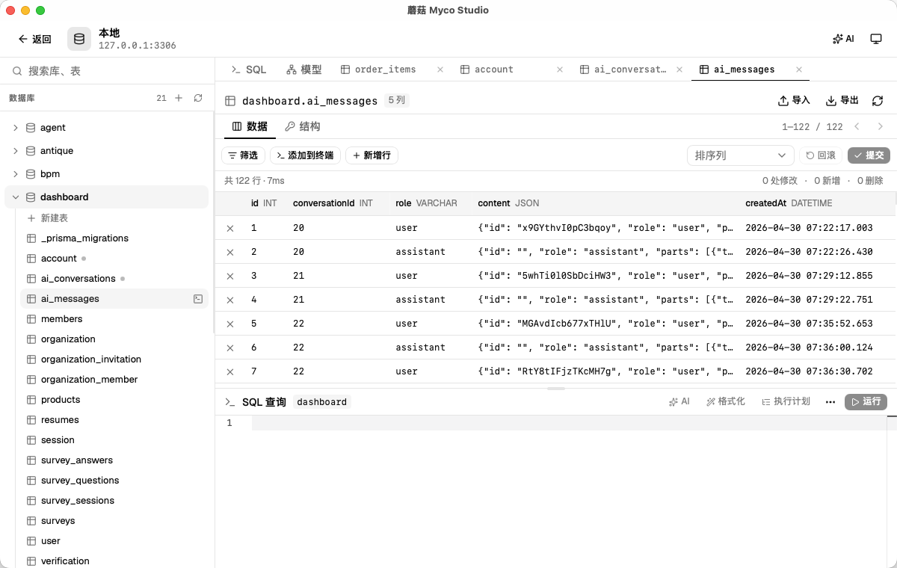
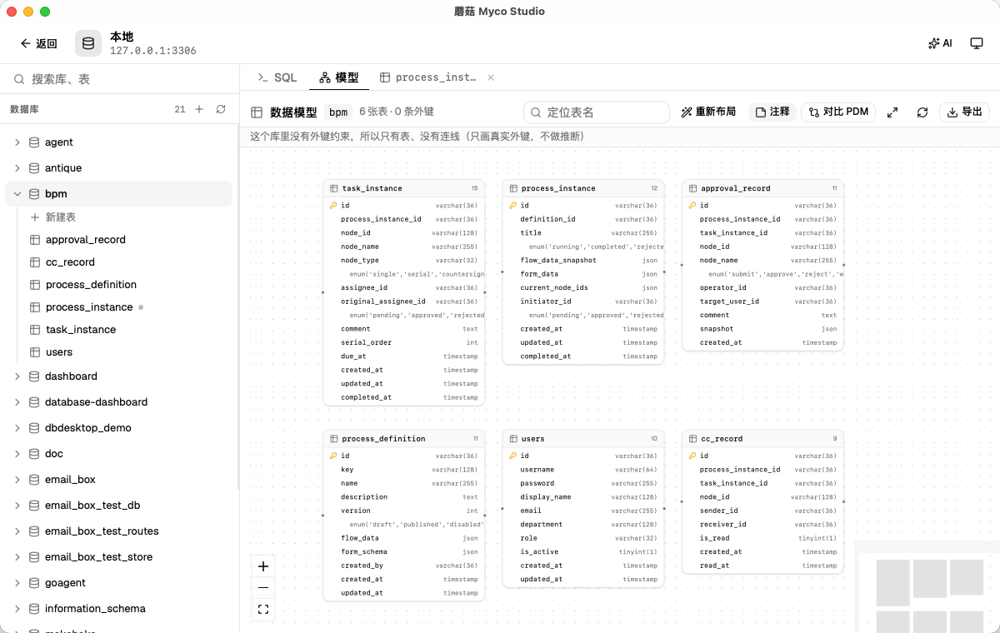
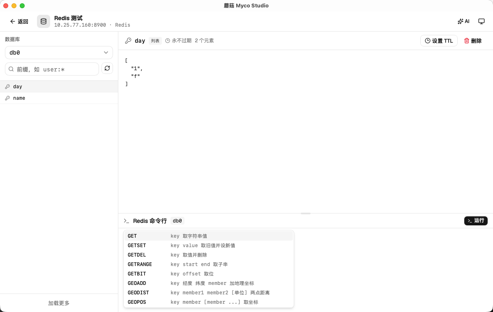
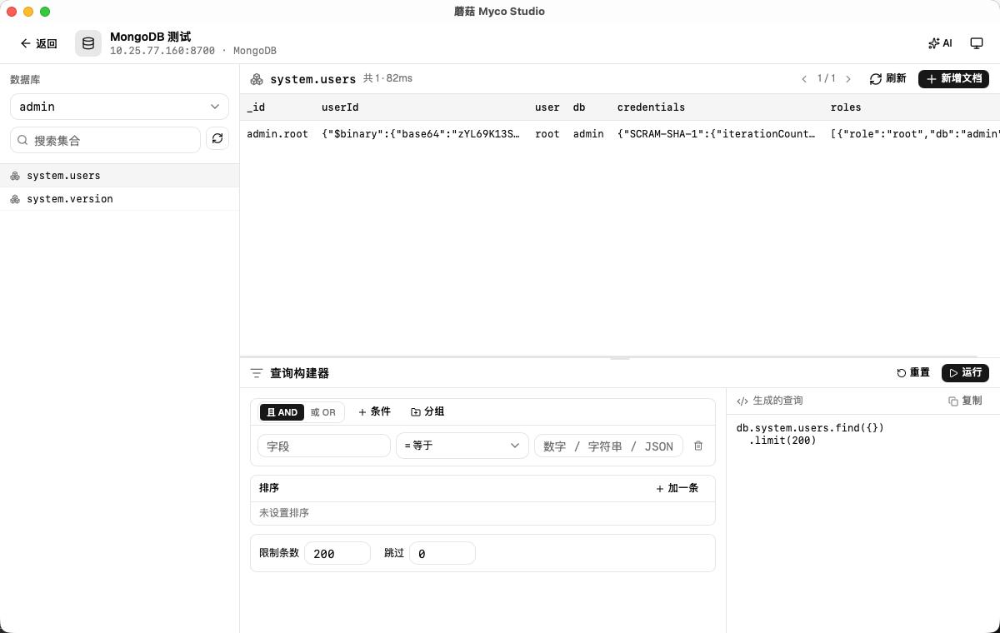
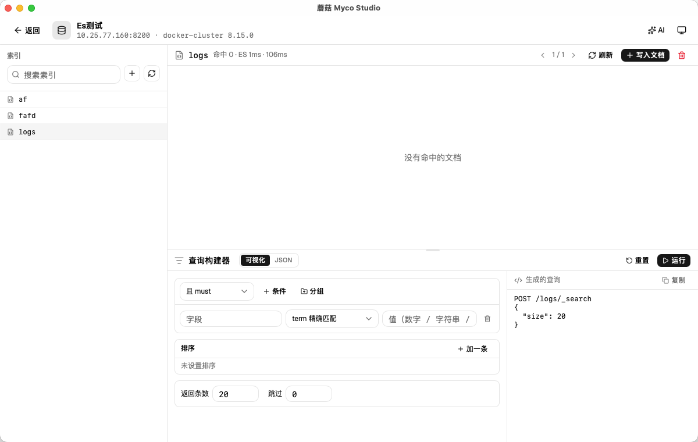
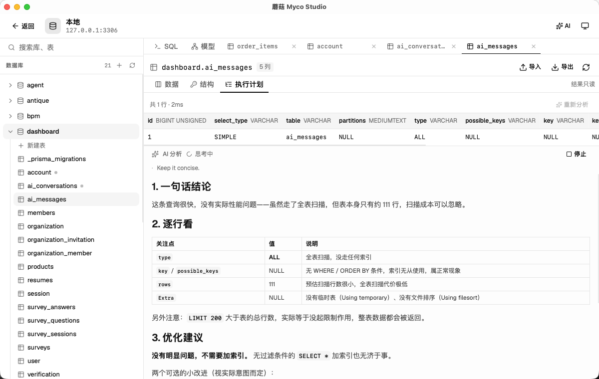

# 蘑菇 Myco Studio

Myco Studio（中文名「蘑菇」）是一个跨平台的桌面数据库客户端：Rust 负责数据层与业务逻辑，Tauri 2 作为桌面壳，React + TypeScript 负责界面。

它把**关系型**和**非关系型**两类数据库放进同一个工作台——同一套连接管理、同一个 AI 助手，按引擎给到贴合语义的界面，不用为了换个数据库再换一个工具。

- 关系型：**MySQL / MariaDB / TiDB**、**PostgreSQL**、**SQLite**、**Oracle**
- 非关系型：**Redis**、**MongoDB**、**Elasticsearch**

驱动按 **RelationalDriver / NonRelationalDriver** 两族抽象：关系型那族围绕「库 / 表 / 字段 / SQL / 结果集」，非关系型那族则各自带一套符合引擎习惯的工作台（Redis 的 key 与命令、MongoDB 的集合与条件树、Elasticsearch 的索引与 Query DSL）。

几点说明：

- **MySQL / MariaDB / TiDB 共用同一个 MySQL 协议驱动**（协议与语法兼容，只有默认端口不同——MySQL / MariaDB 为 3306，TiDB 为 4000），不是三份独立实现。
- Oracle 走 Oracle 官方的 [`oracledb`](https://github.com/oracle/rust-oracledb)（rust-oracledb）thin 驱动：纯 Rust 实现、**不需要 Instant Client / OCI 动态库**，安装包不带任何 Oracle 客户端；支持 Oracle 19c / 21c / 26ai。
- Elasticsearch 直接走 REST（reqwest），不引官方 client，请求与响应原样可见。

## 功能

### 连接管理

- 卡片式连接列表，支持按名称 / 主机 / 用户名搜索与刷新
- 新建 / 编辑 / 删除连接；连接状态按需测试（连接正常 / 连接失败 / 未测试）
- 引擎：MySQL / MariaDB / TiDB（共用 MySQL 驱动）+ PostgreSQL + SQLite（本地文件）+ Oracle（服务名 / SID，可选 SYSDBA / SYSOPER，默认端口 1521）+ Redis（逻辑库 0–N）+ MongoDB（认证库 / 默认库）+ Elasticsearch（Basic Auth + HTTPS，默认端口 9200）
- **SSL**（MySQL / PostgreSQL）：可选 禁用 / 优先 / 必需 / 校验 CA / 校验证书身份，可指定 CA 证书、客户端证书与私钥
- **HTTPS**（Elasticsearch）：一个开关，自签证书自动跳过校验
- **SSH 隧道**：经跳板机连接内网数据库（主机 / 端口 / 用户名 + 私钥或密码），本地转发端口自动分配，断开时回收隧道；Redis / MongoDB / Elasticsearch 同样复用这套隧道
- 连接配置、网络库密码、跳板机口令、AI 供应商、SQL 历史与收藏**全部存在本地 SQLite**（`local.sqlite`，文件权限 600，明文存储）；升级时会自动把旧的 `connections.json` / `ai-providers.json` 和 localStorage 里的 SQL 历史、收藏导入新库；SQLite 连接只需文件路径



### 关系型工作台（MySQL / MariaDB / TiDB / PostgreSQL / SQLite / Oracle）

- 左侧「库 → 表」对象树，可搜索（支持 `库名`、`表名`、`库名.表名`），可刷新；悬停表名可「在 SQL 编辑器中查询」
- 可新建数据库（MySQL 系）或 schema（PostgreSQL）：左侧「数据库」栏点 `+`，可选字符集 / 排序规则
- 右侧多标签：一个 SQL 标签 + 每张打开的表一个标签（表标签记住所属库，切换数据库不清空已打开的标签；标签栏可横向滚动）
- SQL 终端：语法高亮编辑器（**关键字 / 表名 / 字段名自动补全**）、运行、**运行全部**、**执行 .sql 文件**、执行计划（EXPLAIN）、格式化、清空
- **多结果标签**：每次运行的结果各留一个标签，可回看对比、单独关闭、导出
- **结果集查看**：双击任意单元格打开右侧「整行详情」抽屉（可上下翻行、JSON 自动美化、BLOB 图片预览、整行复制为 CSV / JSON / Markdown / TSV）；单击单元格弹窗查看单个字段
- 历史记录 / 收藏记录（收藏时命名，可加载、删除）
- 表数据预览：分页浏览、按列筛选（等于 / 不等于 / 大于 / 小于 / 大于等于 / 小于等于 / 包含）、排序、「添加到终端」把当前筛选与排序拼成 SQL；默认最多加载 1 万行并标出「已截断」
- 在表标签里执行单表 `SELECT`：自动把 WHERE / ORDER BY 解析成筛选与排序，回到可编辑视图；查的是别的表则自动另开标签页
- **外键跳转**：外键列可一键跳到被引用的表并定位到那一行
- **深色 / 浅色 / 跟随系统**主题，Monaco 编辑器同步换肤；设置页含「常规 / 外观」
- 「数据 / 结构」子标签 + 按需出现的「执行计划」子标签；上下/左右面板可拖拽调整大小



### 数据模型与建模（ER 图 / PowerDesigner）

- **数据模型**：工作台「模型」标签把当前库的物理模型画出来——表节点列出字段（主键带钥匙、外键带链接图标），**只连库里真实存在的外键约束**，没有外键就不连线；可拖拽、缩放、小地图、按表名定位，双击表节点打开该表的表标签；**按住空格移动鼠标即可平移画布**（不用按左键，指针停在表节点上也生效）
- **正向建模**：连接管理页「打开 PDM」进去的模型视图，点「编辑」进入编辑模式——新建表或双击表节点打开编辑器，改表名 / 逻辑名 / 注释、字段、索引、外键，也能把整张表从模型里删掉；只改模型、不碰数据库，改完可导出 DDL / PDM，或直接对比数据库生成 ALTER（工作台里的「模型」标签是只读视图，用于看当前库的物理模型、对比 PDM 与导出）
- **模型对比**：挑一个 PowerDesigner 文件与当前库对比——画布上绿框 = 库里缺、红框 = 库里多出来、黄框 = 有差异；面板按表列出「新建表 / 加字段 / 改字段 / 加索引 / 加外键 / 改表注释」，每条可勾选并实时生成对应方言的 ALTER 脚本，可复制或另存为 `.sql`；破坏性改动默认不勾选，每条可「忽略」，勾选与忽略状态按「连接 + 库 + 对比目标」存本地库；确认后可「执行到库」
- **PDM Reader**：连接管理页可一次打开多个 PowerDesigner `.pdm` 文件，每个文件一个标签（固定宽度、横向滚动、左右箭头）。解析表 / 字段 / 主键 / 外键 / 索引，用同一套画布画关系图；**全局搜索**表名或字段名时只展示命中的标签（命中标签蓝色闪动 + 命中表数量），画布只画命中表及其直接关联表；**打开过的文件和当前标签会被记住**，下次启动自动恢复（文件已被移走的会跳过并提示）。**关掉标签也能找回来**：右上角「最近」下拉和空列表里的「最近打开」都来自本地库登记，点一下就能重新打开（已经在标签里的会直接切过去）
- **字段笔记**：PDM 里每个字段后面有一个笔记 icon，点开是带动画的浮层，内置 Tiptap 编辑器（输入 `/` 弹出块命令：标题、列表、引用、代码块等）。内容按 Markdown 存在本地库，按「PDM 文件 id + 表 + 字段」关联——**不改 PDM 文件本身**；打开文件时会在本地库登记并分配一个稳定 id，同一路径始终复用同一个 id
- 导出支持 **PNG / SVG**（整个模型或当前视图）/ **PDM**（回存成 PowerDesigner 文件）/ DbML / Mermaid / Markdown / 整库 DDL
- 大模型也能画：几百张表先按真实外键切成连通块，块内 dagre 分层、块之间货架式摆放；导出图片按布局数据直接拼 SVG（不走 DOM 克隆），PNG 再光栅化一次并限制在 1600 万像素内



### Redis 工作台

- 左侧逻辑库切换（`db0`–`dbN`）与 key 前缀搜索，走 `SCAN` 游标分页，不会阻塞实例
- key 详情按类型渲染：string / hash / list / set / zset / stream；string 可直接编辑并设置 TTL，任意 key 可删除
- **命令行**：单行工具栏 + 可拖动的命令区；命令名与当前库 key **自动补全**（↑↓ 选择、Tab 补全、Esc 关闭），↑↓ 翻历史，多次执行的命令与结果滚动回显，可一键清空
- 命令结果展示在上方内容区，key 详情与命令结果分区查看



### MongoDB 工作台

- 左侧「库 → 集合」浏览，可搜索、可切换数据库
- 上方命中文档表格：列取文档顶层字段并集，`_id` 固定放最前；顶部显示命中总数与耗时，带分页
- **可视化查询构建器**：条件树支持**嵌套条件组**（且 AND / 或 OR），单条条件为「字段 + 操作符 + 值」，操作符覆盖 `= / ≠ / > / ≥ / < / ≤ / in / nin / exists / regex / size / all`；可加排序（多字段、升/降序）与 limit / skip
- 实时预览生成的查询，例如 `db.users.find({ age: { $gt: 18 } }).sort({ age: -1 }).limit(10)`，可一键复制；字段输入带当前集合的字段提示
- 编译规则：同一字段多条自动用 `$and`，不同字段与子 `$or` 平铺成兄弟键
- 文档详情用 JSON 编辑器查看 / 编辑（按 `_id` 整份替换）、新增文档、删除文档；日期与 ObjectId 按扩展 JSON 正确还原回 BSON 类型



### Elasticsearch 工作台

- 左侧索引列表，可搜索、可刷新，也可**新建 / 删除索引**（新建时可填可选的 settings / mappings）；右上角展示集群名与版本
- 上方命中结果表格：列取 `_source` 字段并集（`_id` 放最前，附带 `_index` / `_score`），显示命中数、ES `took`、耗时，带分页
- **可视化 DSL 构建器**：按 `bool` 的四个槽位组织——且 must / 或 should / 非 must_not / 过滤 filter，每个槽位既能加条件也能加**嵌套子分组**；条件操作符覆盖 term / match / match_phrase / range / exists / wildcard / prefix / regexp，另有排序与 size / from
- 实时预览 `POST /<index>/_search` 的完整 DSL，可复制；另有 **JSON 模式**直接手写查询体
- 可写入文档（`_id` 可选，留空由 ES 生成）、点命中文档查看完整 JSON、按 `_id` 删除



### 数据编辑

- 双击单元格直接编辑（回车 / 失焦生效、Esc 取消）；单击弹出单元格详情，**按字段类型渲染控件**（数字 / 布尔 / 日期时间 / 枚举 / 集合 / JSON / 二进制），文本与 JSON 可格式化、可设为 NULL（与空串区分）、可复制整行
- 「新增行」用弹窗填写（按字段类型渲染控件，留空即交给数据库默认值）；每行最左侧可删除行；新增行自动滚动到可视区
- 改动先本地暂存并高亮（已修改 / 待新增 / 待删除），点「提交」在一个数据库事务里统一写入，任一条失败整体回滚；「回滚」丢弃本地改动
- 以主键定位行；无主键的表默认只读，可手动指定定位列后开启编辑
- **提交前校验影响行数**，并用被修改列的原始值做乐观并发校验；冲突时报出「第几条改动」并高亮那一行
- 暂存按定位值跟踪，切页 / 改筛选 / 排序后不会错位

### 表结构（DDL）

- **新建表**：字段（名称 / 类型 / 可空 / 主键 / 自增 / 默认值 / 注释）、索引（唯一 / 复合）、字符集与排序规则、表注释；字段可拖动排序，建表语句实时预览
- **改表**：加列 / 改列（类型、可空、默认值、注释）/ 删列 / 加索引 / 删索引 / 改表注释 / 清空表 / 删除表
- 所有 DDL 先生成语句预览；删列、删索引、删表、清空表需输入名称确认
- 「结构」子标签展示列名 / 类型 / 可空 / 默认值 / 注释，下方列出索引（名称 / 列 / 唯一 / 主键），可一键复制建表语句
- 「删索引」直接从事先读到的索引列表里选，不用手打名字（主键索引不在列表里）

### 数据进出

- **导出 CSV / JSON / SQL INSERT**：整表导出走流式写文件，带当前筛选与排序、不受结果表格 1 万行上限约束；也可以导出当前查询结果集。CSV 带 UTF-8 BOM，Excel 打开不乱码；SQL 会按方言生成 `INSERT INTO` 语句
- **导入 CSV**：自动识别分隔符与 UTF-8 / GBK 编码；列名自动匹配并可手动调整映射；可选「跳过错误行」并列出每行错误
- **执行 .sql 文件**：逐条执行，遇错报出第几条失败

写操作与结果提示统一走右下角 toast，不插入页面挤动布局。

### AI 助手

- 右侧抽屉，多轮对话、按连接分会话、支持选择供应商与模型；回答流式按 Markdown 渲染，思考过程默认只占一行（可展开），并随回答一起存本地库，重新打开会话还能看到
- **执行计划分析**：配好供应商后，跑执行计划会在结果表格下方自动让模型分析一遍（全表扫描 / 没走索引 / 临时表 / 文件排序 / 预估行数偏大），给出的 `CREATE INDEX` 可一键填进 SQL 编辑器
- 助手会按当前引擎给到对应上下文：关系型带上相关表的 DDL，MongoDB 带上当前库的集合清单，Elasticsearch 带上集群信息与索引清单，Redis 给命令级建议
- 供应商（OpenAI 兼容接口）在设置里管理：添加 / 编辑 / 删除、设为默认、同步或手填模型、测试 Token 是否有效



## 技术栈

**后端**

- **Rust**（edition 2024）+ **Tauri 2**
- 关系型：**sqlx**（MySQL / PostgreSQL / SQLite，含 TLS；本地配置库也是 SQLite）、**oracledb**（Oracle 官方 thin 驱动，纯 Rust、无客户端依赖）
- 非关系型：**redis-rs**（原生 async）、**mongodb-rs**（含 `bson`）、**reqwest**（Elasticsearch REST）
- 其他：**russh**（SSH 隧道）、**rig-core**（AI 对话）、**quick-xml**（PowerDesigner `pdm` 解析）、**csv** + **encoding_rs**（导入导出与编码）、tokio、serde、chrono、uuid

**前端**

- **React + TypeScript + Vite**、Tailwind CSS、**shadcn/ui**、**Monaco Editor**（SQL 编辑与补全）、**React Flow** + **dagre**（ER 图 / PDM 画布与自动布局）、**Zustand**（状态）、**motion**（页面与卡片过渡）、**sonner**（toast）

## 架构

Rust 后端分层：

- `domain`：共享类型（`Value` / `Column` / `ResultSet` / `ConnectionConfig` / `FilterSpec` / `DbFlavor` 等）
- `driver`：按 **`RelationalDriver` / `NonRelationalDriver`** 两族抽象
  - 关系型：`mysql.rs`（MySQL / MariaDB / TiDB 共用）、`postgres.rs`、`sqlite.rs`、`oracle.rs`（官方 thin 驱动，阻塞 API 包在 `spawn_blocking` 里、单会话加锁串行）
  - 非关系型：`redis_driver.rs`、`mongodb_driver.rs`、`elasticsearch_driver.rs`
  - 方言差异（标识符引号、占位符、空值安全比较、分页子句）在 `driver` 层统一处理
- `service`：连接管理、结构内省（库 / 表 / 字段 / 注释 / 外键 / 索引）、查询与分页、导入导出、AI 供应商与对话、`pdm` 解析
- `storage`：统一落在本地 SQLite（`local.sqlite`）——连接配置、密码 / SSH 口令、AI 供应商、AI 会话、SQL 历史与收藏、设置
- `ssh_tunnel`：SSH 隧道（russh）+ 本地端口转发，生命周期跟随连接，所有引擎共用

前端通过 Tauri command（IPC）调用后端，自身不含数据库逻辑。

## 目录结构

```
src/                    # React 前端（components / lib / store）
  components/           # 各工作台与对话框（含 Redis / MongoDB / Elasticsearch 工作台）
  lib/                  # API 封装、SQL / 查询编译、导出、主题等
src-tauri/src/          # Rust 后端
  domain.rs             # 领域类型
  driver/               # 关系型 + 非关系型各驱动与两族 trait
  service/              # 连接管理、内省、查询、导入导出、AI、pdm 解析
  storage/              # 本地 SQLite：连接配置、密钥、设置、历史与收藏
  ssh_tunnel.rs         # SSH 隧道与本地端口转发
  commands.rs           # Tauri command（IPC）
scripts/                # 工具脚本（如生成 macOS 风格应用图标）
images/                 # README 里用到的界面截图
```

## 开发

需要 Node.js 与 Rust（stable）。

```bash
npm install
npm run tauri dev      # 开发模式，前端热更新；改 Rust 后会自动重编译重启
```

打包正式版：

```bash
npm run tauri build    # 产出 .app / .dmg（macOS）
```

## 测试

```bash
cd src-tauri
cargo test
```

除单元测试外，各引擎都留了「需要真实实例、默认忽略」的集成测试，用环境变量提供连接信息后加 `--ignored` 运行，例如：

```bash
# MySQL
DB_HOST=127.0.0.1 DB_PORT=3306 DB_USER=root DB_PASSWORD=<密码> \
  cargo test mysql::tests -- --ignored --nocapture

# PostgreSQL
PGHOST=127.0.0.1 PGPORT=5432 PGUSER=postgres PGDATABASE=postgres PGPASSWORD=<密码> \
  cargo test postgres::tests -- --ignored --nocapture

# Oracle（服务名 / SID + SYSDBA、对象树、分页筛选、日期与 BLOB、外键、视图 DDL、
#        事务提交与乐观并发、执行计划、AI 上下文）
MYCO_ORA_HOST=<主机> MYCO_ORA_PORT=1521 MYCO_ORA_USER=appuser MYCO_ORA_SERVICE=XEPDB1 \
  MYCO_ORA_PASSWORD=<密码> \
  cargo test --lib -- --ignored --nocapture oracle
```

## 已知坑

### 大结果集下，界面交互会随行数变慢

**现象**：SQL 查回上万行后，在结果网格里点单元格，弹窗要 1.5 秒左右才出来；而左侧点开的表几乎无感——因为那条路每页只取 200 行。

**实测**（应用内打点，不是估算）：

| 场景 | 点击→定时器 | 定时器→setState | setState→绘制 | 总计 |
| --- | --- | --- | --- | --- |
| 分页表（200 行） | 201ms | 0ms | 102ms | 303ms |
| SQL 结果集（10000 行）· 修复前 | 201ms | 0ms | 1383ms | 1584ms |
| SQL 结果集（10000 行）· 修复后 | 201ms | 0ms | **51ms** | **252ms** |

其中 200ms 是单击打开弹窗前的固定延时，用来区分单击（看单元格）和双击（行内编辑），属有意设计，没有去掉。

**根因**：结果网格把返回的每一行都渲染进 DOM（不分页、不做窗口化），于是两个代价都随行数线性增长：

1. 任何状态变化（开弹窗、切结果标签、编辑器里每敲一个字符）都会让 React 重新协调全部行；
2. 弹窗这类「插入到页面顶层」的动作会触发整页样式与布局重算，浏览器要为上万行重算一遍。

**排查时被排除的两个假设**（都不是主因，别重复走）：

- 用 `useMemo` memo 行渲染：总计只从 1584ms 降到 1530ms，React 侧不是大头；
- 去掉弹窗遮罩那层全屏毛玻璃（`backdrop-blur`）：仍是 1328ms。

**修法**：用 [`@tanstack/react-virtual`](https://tanstack.com/virtual) 给结果网格做行虚拟化，只渲染可视区的几十行（见 [ResultsGrid](src/components/ResultsGrid.tsx)）。DOM 从 1 万行降到几十行，上面两个代价一起消失。

两个配套细节，改的时候别漏：

- **列宽要固定**：虚拟化之后列宽如果还由「当前渲染了哪几行」决定，滚动时列会跳。所以表格改成 `table-fixed` + `<colgroup>`，宽度按表头和前 50 行估一次。
- **「定位到某一行」要换实现**：原来是 `scrollIntoView` 找 `[data-row]` 节点，屏幕外的行已经不在 DOM 里了，改成 `virtualizer.scrollToIndex(n, { align: "center" })`。

**尚未实机验证**：「定位到行」那几条路（提交失败回跳、外键跳转）只做了代码层面的替换，没有真正触发过。

**同一套做法也用在了其它大列表上**（都只渲染可视区）：

| 位置 | 列表 |
| --- | --- |
| [DocumentTable](src/components/DocumentTable.tsx) | MongoDB 文档表、Elasticsearch 命中表（两者共用这个组件） |
| [RedisWorkspace](src/components/RedisWorkspace.tsx) | key 列表、命令行回显（回显每条高度不一，用 `measureElement` 实测） |
| [ObjectExplorer](src/components/ObjectExplorer.tsx) | 对象树——嵌套树没法直接虚拟化，先摊平成「一行一个节点」再渲染，缩进在渲染时补 |
